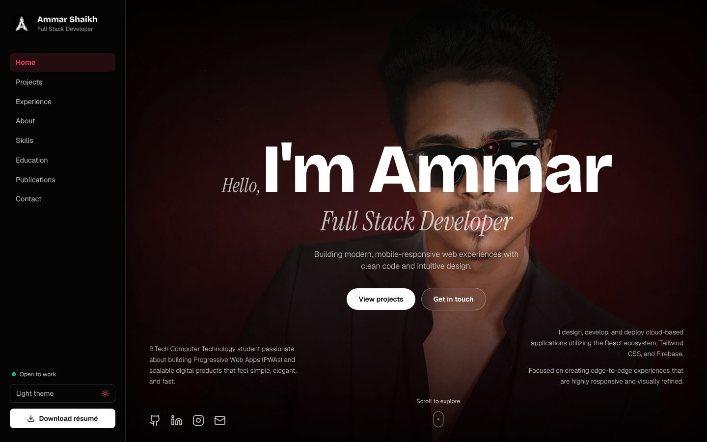

# Ammar Shaikh | Portfolio

Personal portfolio of Ammar Shaikh, Full Stack Developer. Built with React 18, TypeScript, Vite, Tailwind CSS and Framer Motion.

**Live:** https://skammar-portfolio.netlify.app/



## What's in it

- **Hero** with a cursor-follow spotlight that reveals a second portrait. On touch screens the spotlight drifts on its own.
- **Intro** that plays once per session, tied to the hero images actually loading. Skipped when the visitor prefers reduced motion. "Replay intro" is in the footer.
- **Light and dark theme**, saved per visitor, applied before first paint (no flash).
- **Left sidebar** on desktop, sticky header and full-screen menu on mobile, with active-section tracking and a scroll progress line.
- **Custom cursor** for mouse users only; touch devices and form fields keep the normal cursor.
- **Sections:** Projects (with case-study modal), Experience, About, Skills, Education, Research, Contact.
- **Research proof:** the published paper, acceptance letter and certificate are linked from the Research section.
- **Video backgrounds** only on wide screens and never when reduced motion or data saver is on; they pause when off-screen.
- **Contact form** that sends through EmailJS when configured, otherwise opens the visitor's email app. Includes a spam honeypot.
- **SEO and sharing:** Open Graph and Twitter cards, JSON-LD `Person` data, `robots.txt`, `sitemap.xml`, web manifest and icons.
- **Accessibility:** skip link, visible keyboard focus, labelled form fields, dialog with Escape and arrow-key support.

## Run it

```bash
npm install
npm run dev        # http://localhost:5173/ammar-portfolio/
npm run build
npm run preview
```

## Deploy to GitHub Pages

```bash
npm run deploy     # builds, then publishes dist/ with gh-pages
```

`vite.config.ts` sets `base: "/ammar-portfolio/"`. If the repo is renamed, change it there and the URLs in `index.html`.

## Contact form with EmailJS (optional)

1. Create a free EmailJS service and template. The template can use `{{from_name}}`, `{{reply_to}}`, `{{subject}}` and `{{message}}`.
2. Copy `.env.example` to `.env` and fill in the three values.
3. Rebuild. Without these values the form falls back to `mailto:`.

## Editing the content

All text lives in `src/data/portfolioData.ts`: personal info, projects, experience, skills, education, research and navigation. Change it there and every section updates.

- Colours are CSS variables in `src/index.css` (`:root` for dark, `:root[data-theme="light"]` for light).
- Replace `public/resume.pdf` with your latest résumé.
- Hero portraits are `public/images/Base_image.webp` and `Reveal_image.webp`. Keep them the same size and aligned.
- Project case studies open from `PROJECTS`. Add a real `githubUrl` and `liveUrl` per project there.

## Structure

```
src/
  components/   Sidebar, HeaderMobile, Hero, Preloader, CustomCursor, ProjectModal, ...
  sections/     Projects, Experience, About, Skills, Education, Publications, Contact
  hooks/        useTheme, useActiveSection, useSpotlightMask
  data/         portfolioData.ts
public/         images, media (videos), docs (paper, certificate), icons, manifest
```
